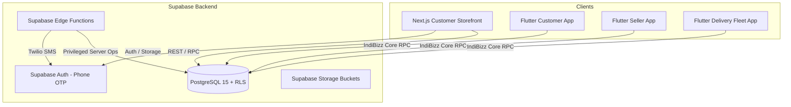

# IndiaBizz Architecture & Engineering Guide

## 1. System Overview

IndiaBizz is a comprehensive hyper-local commerce, logistics, and Cash-on-Delivery (COD) fulfillment platform built on:
- **Database Engine**: PostgreSQL 15+ hosted on Supabase with Row Level Security (RLS) enforcing multi-tenant isolation, role boundaries, and immutable financial ledgers.
- **Edge Backend**: Supabase Edge Functions (Deno / TypeScript) providing OTP dispatch, document generation (invoices & shipping labels), background assignment expiry, and push notifications.
- **Client Web Application**: Next.js 15 (React 19, TypeScript, TailwindCSS) customer storefront.
- **Client Mobile & Desktop Applications**: Flutter monorepo consisting of:
  - `packages/indibizz_core`: Shared domain models, Supabase API clients, auth controllers, theme systems, and core widgets.
  - `apps/seller_app`: Seller / Business Owner console for inventory, order approvals, logistics dispatch, COD reconciliation, and team governance.
  - `apps/delivery_app`: Delivery fleet app for drivers and partner couriers supporting pickup OTP verification, in-transit telemetry, proof-of-delivery photo capture, customer delivery OTP verification, and cash custody management.
  - `apps/customer_app`: Native shopping app with catalog browsing, real-time PIN code serviceability validation, cart management, doorstep COD checkout, and delivery tracking timelines.

---

## 2. Security & RLS Model

Every table in IndiaBizz has Row Level Security enabled. Clients (authenticated users with `anon` or `authenticated` JWTs) never write directly to sensitive financial or status fields.

1. **Role Enforcement**:
   - `OWNER`: Full administrative read/write authority across stores, catalogue, pricing, inventory movements, settlements, and staff.
   - `OWN_DELIVERY_STAFF`: Read access to assigned deliveries and pickups; ability to update delivery state via verified OTP functions.
   - `PARTNER_ADMIN`: Administrative authority over third-party delivery partner fleets and assigned delivery staff.
   - `PARTNER_DELIVERY_STAFF`: Scoped execution of assigned partner deliveries and pickups.
   - `CUSTOMER`: Access strictly isolated to own profiles, cart items, delivery addresses, and placed orders.

2. **Privileged Function Architecture**:
   - Status transitions (e.g. `PENDING_APPROVAL` -> `APPROVED` -> `READY_FOR_PICKUP` -> `PICKED_UP` -> `OUT_FOR_DELIVERY` -> `DELIVERED`) are executed exclusively through PostgreSQL `SECURITY DEFINER` stored procedures.
   - Financial modifications (COD collected, cash settlements, stock reservation and release) write append-only audit entries to `stock_movements`, `cod_settlements`, and `order_status_history`.

---

## 3. Storage Buckets

The platform configures dedicated private and public storage buckets:
- `product-images`: Public bucket containing optimized product imagery.
- `invoices`: Private bucket storing signed PDF tax invoices.
- `delivery-proofs`: Private bucket storing camera captures and digital receipts submitted by delivery staff upon order completion.
- `return-evidence`: Private bucket holding customer photos of damaged/incorrect items.
